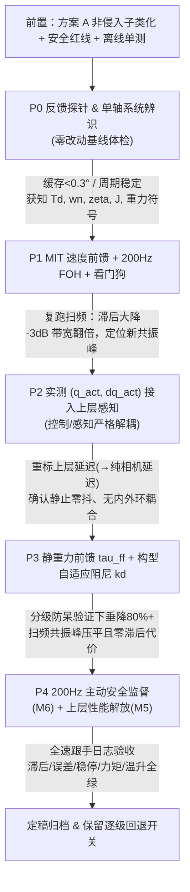

# MIT 底层参数辨识、标定与闭环开发通用指南

> 本文整理自 **Seeed reBot Arm B601-RS（6-DOF + J7 夹爪）** v13.0 底层重构（P0~P4）的全流程实战经验，将其中**反馈探针、单轴系统辨识、速度前馈、真实状态解耦、静重力补偿与构型自适应阻尼**抽象为一套**可复用于任意新 MIT 机械臂**的标准化开发方法论。

---

## 一、先给结论：这套流程对新机械臂是否通用？

**是的，核心方法论、数学模型与五阶段门禁流程具有极高的通用性（约 90% 可直接迁移）。**

只要目标机械臂满足以下两个前提，即可完整套用本指南：
1. **驱动层支持 MIT / 阻抗力矩混合控制指令**：即能周期性下发 $(q_{\text{des}}, \dot{q}_{\text{des}}, k_p, k_d, \tau_{\text{ff}})$ 并读回关节状态 $(q_{\text{act}}, \dot{q}_{\text{act}}, \tau_{\text{act}}, T_{\text{mos}})$（典型代表：灵足 RobStride、达妙 DM 系列、宇树 A1/Go/B1 电机、CubeMars AK 系列、ODrive/VESC 准直驱 QDD 关节、轻型力控协作臂）；
2. **有运动学与基本惯量模型（URDF / Pinocchio / MuJoCo）**，用于正逆运动学与静重力项 $g(q)$ 计算。

### 不同类型机械臂的适用边界

| 机械臂类型 | 适用度 | 迁移差异与注意事项 |
| --- | --- | --- |
| **准直驱 / 低中减速比 MIT 臂**（如 B601-RS、达妙/灵足/CubeMars 自研臂） | **100% 适用** | 全部 P0~P4 阶段直接套用，收益最大（滞后可压降 70%~85%，下垂降 80%+） |
| **带实时力矩/电流接口的协作臂**（如 Franka、KUKA iiwa、部分力控国产协作臂） | **90% 适用** | 底层多已内置重力补偿，重点复用 P0 扫频辨识、P1 速度前馈/插值、P2 实测位姿解耦与 M6 监督逻辑 |
| **高减速比谐波 + 纯位置控工业臂**（不开放 $\dot{q}_{\text{des}}$ / $\tau_{\text{ff}}$） | **部分适用** | 无法做 P1/P3 底层力矩注入，但 **P0 阶跃/扫频延迟与带宽辨识**、**P2 实测位姿与控制解耦**、**上层延迟对齐**依然完全适用 |
| **无外接力矩/电流反馈的低成本舵机臂** | **不适用 P3/M6 力矩项** | 只能做位置级带宽辨识，无法做实测力矩校验与力矩堵转保护 |

---

## 二、物理本质：为什么 MIT 机械臂不能靠“盲调 $k_p / k_d$”？

所有 MIT 模式的关节电机，内部执行的是同一条控制律：

$$\tau_{\text{motor}} = k_p (q_{\text{des}} - q_{\text{act}}) + k_d (\dot{q}_{\text{des}} - \dot{q}_{\text{act}}) + \tau_{\text{ff}}$$

很多开源项目和厂商默认 SDK 只把它当“高级位置模式”用——把 $\dot{q}_{\text{des}} = 0$、$\tau_{\text{ff}} = 0$ 写死，只发目标位置 $q_{\text{des}}$。这会立刻制造**两个结构性死结**：

1. **静态重力下垂死结（$\tau_{\text{ff}} = 0$）**
   悬臂静止时，电机只能靠位置误差产生的弹簧力托住自重与负载：
   $$q_{\text{des}} - q_{\text{act}} \approx \frac{\tau_g(q)}{k_p}$$
   若为了减小下垂而硬拉高 $k_p$，机械臂会变得刚硬、高频振颤、碰撞危险激增；不拉高 $k_p$，肘腕就会常年下垂 $2^\circ\sim 5^\circ$，直接污染末端视觉和定位精度。
2. **带宽与阻尼不可兼得死结（$\dot{q}_{\text{des}} = 0$，最关键的反直觉结论）**
   当 $\dot{q}_{\text{des}} = 0$ 时，阻尼项退化为 $-k_d \dot{q}_{\text{act}}$——它不仅抑制振动，还在机械臂**正常跟随运动时拼命踩刹车**！
   在低频跟随段，纯位置 PD 闭环会凭空制造出巨大的等效相位滞后：
   $$\tau_{\text{lag}} \approx \frac{k_d}{k_p}$$
   - 以 B601-RS 手腕 J4 为例：$k_p = 50, k_d = 5$，单这一项就带来 $5/50 = 100\text{ ms}$ 滞后，叠加机械摩擦后 0.5Hz 实测滞后高达 **$142\text{ ms}$**，$-3\text{ dB}$ 带宽仅 $1.5\text{ Hz}$！
   - 更致命的是：一旦你想调大 $k_d$ 来压共振，滞后会进一步恶化；想调小 $k_d$ 来提速，悬臂就会剧烈振荡。

**破局原理**：
- 一旦引入**速度前馈 $\dot{q}_{\text{des}}$**，$k_d(\dot{q}_{\text{des}} - \dot{q}_{\text{act}})$ 变成**只阻尼速度跟踪误差、不拖慢参考轨迹**的纯阻尼器——**彻底解耦了“高带宽”与“强阻尼”的矛盾**！
- 一旦引入**静态重力前馈 $\tau_{\text{ff}} = \alpha \cdot g(q)$**，$k_p$ 不再需要硬扛重力，静差下降 80%+，且不增加任何高频刚度风险。

---

## 三、标准化五阶段开发流程（P0 → P4 门禁法）

切忌一次性把“速度前馈 + 重力补偿 + 增益调度 + 上层提速”全部合在一起上真机——一旦出现振荡或过冲，根本无法定位根因。推荐严格采用**五阶段增量门禁法**，每一阶段都有**独立实验、定量验收门槛、独立一键回退开关**：

---

### 架构前置：工程安全红线（上真机前必须先写好）

在接手一台新机械臂写任何底层控制代码前，先立住四条不可违背的工程原则：

1. **非侵入式扩展（方案 A 子类化）**：尽量不要直接魔改原厂 SDK 源码，而是在本工程中子类化原厂控制器，启动时校验上游核心文件的 `SHA256`；校验失败或配置 `enable: false` 时自动无痛回退原厂控制器。
2. **任何异常绝不在半空/屈肘姿态直接失能**：
   - 上游驱动常见隐患：单次 CAN 发送异常就立即 `disable()`，导致重臂自由下落砸坏硬件。
   - 标准改造：引入 `CanFaultMonitor`（例如 200Hz 下连续失败 $\ge 30\text{ ms}$ 即 6 拍才判定真通信故障），触发后优先走**缓慢平滑回零（`return_to_zero=True, wait=True`）再失能**。
3. **每项特性独立开关 + 离线单元测试**：`vel_ff_enable`、`gravity_ff_enable`、`gain_sched_enable`、`supervisor_enable` 各自独立开关；所有纯数学函数（FOH、看门狗、重力淡出、二阶拟合、安全监督）必须先跑通离线单测再上硬件。
4. **单位与坐标系边界封装在适配层**：若电机 SDK 用“度”而动力学库（Pinocchio）用“弧度”，所有角度转换、关节零位偏置 `joint_offset.json` 必须严格收敛在 Adapter 层，禁止散落到控制循环里。

---

### 阶段 P0：通信/反馈体检 + 单轴系统辨识（先测准，再动手）

> **目标**：不动任何控制增益、不发任何前馈，纯摸底新机械臂的“真实体检报告”。
> **对应工具**：[mit_feedback_probe.py](file:///home/tony/wey/rebot_developer/rebot_CV_control/rebot_palm_follow_grasp/tools/mit_feedback_probe.py)、[joint_sysid.py](file:///home/tony/wey/rebot_developer/rebot_CV_control/rebot_palm_follow_grasp/tools/joint_sysid.py)

#### Step P0.1：高频反馈缓存探针（必做第一件事）
许多 CAN 电机在发送 MIT 指令后，应答帧本身就带回了 $(q, \dot{q}, \tau, T_{\text{mos}})$，但上层 SDK 往往仍习惯用阻塞式寄存器查询（如 RobStride `0x7019`）去读当前角度，单次阻塞可达 `50~60 ms`。

**在零位与安全悬臂位姿（HOME）分别运行探针，核对 6 项指标**：
1. **刷新率**：对比“不主动轮询 RX”与“每拍 `poll_once`”两种模式的 `valid_ratio` 和 `change_ratio`（应达 `100%`）；
2. **精度校验**：缓存角度 vs 阻塞式寄存器真值的逐轴最大偏差（门槛：`< 0.3°`，B601-RS 实测仅 `0.0139°`）；
3. **实时性开销**：采样耗时 P99（应 `< 0.5 ms`，B601-RS 实测 `0.19 ms` vs 阻塞读取 `57.6 ms`）与 200Hz 周期 P99（应 `< 6.0 ms`）；
4. **静止速度量化噪声 $\sigma_{\dot{q}}$**：机械臂静止时读取 500 帧 $\dot{q}_{\text{act}}$ 的标准差（B601-RS 实测 `0.036~0.073 rad/s`），这是 **P2 速度滤波器时间常数的直接设计依据**；
5. **静态重力下垂初测**：记录每轴 $q_{\text{cmd}} - q_{\text{act}}$；
6. **Pinocchio 重力符号与幅值初核（最关键安全检查！）**：
   - 将实测静态力矩 $\tau_{\text{act}}$ 与 Pinocchio 计算的 $g(q)$ 逐轴对比；
   - **符号必须 100% 一致**（若某轴符号相反，说明该关节电机安装方向或 URDF 关节轴定义取反，此时直接上重力补偿会正反馈飞车！必须先修正符号映射）；
   - 若 $|\tau_{\text{act}}|$ 系统性大于 $|g_{\text{URDF}}(q)|$，立即检查是否漏建了末端夹爪、相机或支架负载。

#### Step P0.2：安全单轴激励辨识（阶跃 + 离散正弦扫频）
**安全约束规范（换任何新臂都应遵守）**：
- 每次只激励 **1 个关节**，其余关节锁在安全位姿不动；
- 小幅激励：阶跃 $\le 2.5^\circ\sim 4.0^\circ$，正弦扫频幅值 $\le 2.0^\circ\sim 3.0^\circ$，峰值角速度硬限 $\le 0.80\text{ rad/s}$，离软限位至少留 $5^\circ$ 余量；
- 实时看护：温升超限或跟踪误差超 `amp + 6°` 立即中止并安全回零；
- 先跑 `--simulate` 离线自检，确认拟合算法无误再上真机。

**两类激励分别测什么**：
1. **小幅正负阶跃响应（提取物理参数）**：
   - 因为 200Hz 指令自带有限斜率，直接套理想单位阶跃会高估延迟；必须用**实际指令斜坡增量 $\Delta u(t)$ 与延迟二阶阶跃响应做离散卷积拟合**：
     $$y(t) = \Delta u * h_{\text{2nd}}(t - T_d;\, \omega_n, \zeta, K)$$
   - 由拟合结果直接反推出物理量：
     - 纯通信/驱动传输延迟 $T_d$（判断瓶颈到底在总线还是在 PD 相位滞后）；
     - 闭环自然频率 $f_n = \omega_n / (2\pi)$ 与阻尼比 $\zeta$（$\zeta < 0.6$ 欠阻尼易振荡，$\zeta > 1.0$ 过阻尼发肉）；
     - 当前位姿下的等效关节转动惯量：
       $$J_{\text{eff}} = \frac{k_p}{\omega_n^2}$$
     - 目标临界阻尼 $\zeta = 0.7$ 对应的理论参考 $k_d$：
       $$k_{d,\,\zeta=0.7} = 2 \times 0.7 \sqrt{k_p J_{\text{eff}}}$$
2. **离散正弦扫频（提取频域 Bode 图）**：
   - 推荐频点：`0.5, 1.0, 1.5, 2.0, 2.5, 3.0, 4.0 Hz`（覆盖人机交互与视觉伺服核心工作频段）；
   - 对每频点跳过前 $1\sim 2$ 个过渡周期，用最小二乘正交投影提取指令与实测的基波幅值与相位，得到：
     - 幅值比 $|H(j\omega)|$（dB）→ 定位 **$-3\text{ dB}$ 带宽**与**共振峰频率/高度**；
     - 相位滞后 $\phi(\omega)$ 与等效时间滞后 $\tau_{\text{eq}} = -\phi / (360^\circ f)$。
3. **双位姿对照（必做）**：
   - 至少在 **近区工作位姿（HOME）** 与 **前伸悬臂位姿（extended）** 各扫一次底座偏航轴（如 J1）与主要承重轴（J2/J3），直接测出伸展半径 $r$ 变化引起的惯量膨胀 $J_{\text{eff}}(r)$（为 P3 构型阻尼调度提供物理依据）。

---

### 阶段 P1：MIT 速度前馈 $\dot{q}_{\text{des}}$ + 200Hz FOH 插值 + 看门狗

> **目标**：打通 $\dot{q}_{\text{des}}$ 通道，消除纯位置 PD 的 $k_d / k_p$ 滞后，把高频控制纹波抹平。

#### 关键设计要点
1. **为什么必须配 200Hz FOH（一阶保持）插值？**
   若上层伺服是 `100Hz`（10ms 一拍）而底层 MIT 线程是 `200Hz`（5ms 一拍），直接零阶保持（ZOH）会产生 `100Hz` 阶梯位置台阶；在每拍内部用 $\dot{q}_{\text{des}}$ 做线性插值（FOH），同时严守**绝不超过目标点与关节软限位**，电机运行丝滑度会明显提升。
2. **分轴 `vel_ff_scale` 整定法则（直接查 P0 辨识的 $\zeta$）**：
   - 欠阻尼轴（如 $\zeta \approx 0.5$，典型为大惯量底座 J1）：先保守取 **`0.65 ~ 0.75`**，防止速度前馈激发超调；
   - 适中阻尼轴（$\zeta \approx 0.7\sim 0.8$，典型为 J2/J3）：取 **`0.80 ~ 0.85`**；
   - 严重过阻尼轻载轴（$\zeta > 1.1$，典型为手腕 J4/J5/J6）：取 **`0.85 ~ 0.95`**，释放最大带宽红利。
3. **四条不可省略的底层安全联锁**：
   - **看门狗指数衰减**：若上层因卡顿超过 $T_{\text{wd}}$（建议 $40\text{ ms}$）未刷新速度指令，200Hz 线程按时间常数 $\tau_{\text{wd}} \approx 30\text{ ms}$ 自动将 $\dot{q}_{\text{des}} \to 0$，防止上层挂死导致机械臂飞车；
   - **轻量速度低通**：在 200Hz 侧对 $\dot{q}_{\text{des}}$ 加 `6~10 ms` 一阶低通，消除电机高频电磁啸叫；
   - **限位接触轴强制归零**：任何触及软限位缓冲的轴，该轴 $\dot{q}_{\text{des}}$ 强制为 `0`；
   - **通道与模式隔离**：夹爪（J7）、`hold()`、点动 `move_to_joints()`、旧版纯位置接口及回零路径，**一律强制 $\dot{q}_{\text{des}} = 0$**。

#### P1 验收方法
1. 复跑 `tools/joint_sysid.py --pose home --with-vel-ff --no-step`：
   - 对比 P0 扫频报告，确认全轴等效滞后显著下降、轻载腕关节 $-3\text{ dB}$ 带宽大幅提升；
   - **特别注意观察新出现的共振凸起**（开启速度前馈后，$k_d$ 不再拖慢相位，原本被过阻尼掩盖的 $2\sim 3\text{ Hz}$ 结构微凸起会浮现出来，这正是 P3 M3 阻尼调度的精准靶点！）。
2. 上层先限半速（如 `max_vel=0.35`）跑一次实际任务，确认无异常后再放开全速，用日志互相关核算真实执行器闭环滞后。

---

### 阶段 P2：真实 200Hz 状态接入上层感知（控制/感知严格解耦）

> **目标**：把 P0~P1 拿到的真实低滞后 $(q_{\text{act}}, \dot{q}_{\text{act}})$ 喂给上层状态估计器，淘汰“拿指令位姿 + 人为猜 140ms 延迟”的土办法。

#### 必须遵守的架构红线（内外环解耦铁律）

| 上层模块 | 使用 `q_act / dq_act`（实测） | 严格保留 `q_cmd`（指令） | 原因 |
| --- | :---: | :---: | --- |
| 世界系 KF 相机历史位姿（Eye-in-Hand） | ✅ | | 真实物理相机就在 `FK(q_act)`，消除下垂和滞后引起的世界系漂移 |
| 相机自运动补偿（速度扣除） | ✅（需先低通） | | 真实运动速度比延迟猜测准一个数量级 |
| 静止保持锚点 `hold_world` | ✅ | | 对齐物理停稳位姿 |
| 控制雅可比 $J(q)$ 与伪逆求解 | | ✅ | 避免反馈噪声和柔性延迟进入速度积分内环造成自激振荡 |
| 工作空间虚拟软/硬墙 & 关节软限位 | | ✅ | 边界约束必须确定、无滞后、无噪声 |
| 关节速度积分 $q_{\text{cmd}} \leftarrow q_{\text{cmd}} + \dot{q}_{\text{cmd}} \Delta t$ | | ✅ | 保证指令轨迹连续单调，防止下垂被积分成发散偏置 |

#### 参数重标步骤
1. **配置实测速度低通滤波器**：依据 P0 测得的静止 $\sigma_{\dot{q}}$（如 `0.04~0.07 rad/s`），取 $\tau_{\text{lpf}} \approx 15\sim 25\text{ ms}$（B601-RS 取 `20 ms`），滤掉编码器差分量化毛刺，防止静止时误判自运动。
2. **重标上层延迟参数**：既然位姿历史已是物理真实 `q_act`，上层延迟补偿不再需要包含执行器滞后（如原 `140 ms`），直接下调至**纯传感器曝光 + 传输延迟**（典型 `20~35 ms`，B601-RS 取 `25 ms`），并将 Smith 预估混合权重推至 `1.00`。
3. **验证方式**：实机跑动静态混合测试，重点确认静止段关节指令速度 P95 严格保持 `0.000 rad/s`，无内外环串扰抖动。

---

### 阶段 P3：静重力前馈 $\tau_{\text{ff}}$ + 构型自适应阻尼调度 $k_d$

> **目标**：消除 $80\%+$ 静态重力下垂，并利用 P1 解耦红利精准压平悬臂共振峰。
> **对应工具**：[p3_gravity_verify.py](file:///home/tony/wey/rebot_developer/rebot_CV_control/rebot_palm_follow_grasp/tools/p3_gravity_verify.py)

#### Step P3.1：静重力建模与外挂负载反推校准
- **为什么只做静重力 $g(q)$，不做全逆动力学 $M(q)\ddot{q} + C(q,\dot{q})\dot{q}$？**
  在视觉伺服或遥操作中，目标加速度 $\ddot{q}$ 含大量噪声，盲目注入惯性力矩极易激发高频振颤；而静重力项 $g(q)$ 只依赖位置 $q$，物理上**绝对无源、无相位噪声、性价比最高**。
- **独立 Pinocchio 线程隔离**：200Hz MIT 线程与 100Hz 运动学线程必须使用**完全独立的 `(_grav_model, _grav_data, _grav_lock)`**，绝不能共享同一个 `pin.Data` 对象，否则多线程竞争会直接算出垃圾力矩或段错误！
- **外挂负载（相机/支架/夹爪）快速反推法**：
  若新机械臂末端装了 URDF 里没有的设备，不必拆下来精确测 CAD 转动惯量，只需在两个不同悬臂姿态（如 HOME 与 extended）采集静态残差：
  $$\Delta \tau(q_k) = \tau_{\text{act}}(q_k) - g_{\text{URDF}}(q_k)$$
  在末端连杆（如 `link6`）局部系挂载一个等效质点 $(m_{\text{payload}}, \mathbf{c}_{\text{payload}})$（质心初值可取手眼标定外参或直尺量测值），调节 $m_{\text{payload}}$ 即可让 J2/J3/J4 三个轴在双姿态下的预测误差同时收敛（B601-RS 反推出 Gemini 2 + 支架等效 $0.32\text{ kg}$、质心 $[0.056, -0.011, 0.095]\text{ m}$）。

#### Step P3.2：五道工程保险 + 分级渐进防呆验收
上真机注入 $\tau_{\text{ff}}$ 前，必须先写死五道防线：
1. **启动淡入（Ramp-in）**：使能后 `0.5 s` 从 `0` 线性淡入，无启动冲击；
2. **斜率硬限制（Slew Cap）**：如 `≤ 30 Nm/s`，杜绝任何跳变；
3. **分轴硬封顶**：按各轴额定力矩设合理上限，且**纯竖直旋转轴（如 J1）与夹爪（J7）恒为 `0 Nm`**；
4. **回零支架平滑淡出（`cradle_zero_fade`）**：机械臂回到机械零位/停靠支架附近（如 $|q_2|, |q_3| < 5^\circ$）自动把 $\tau_{\text{ff}}$ 光滑淡出至 `0 Nm`，防止靠在支架上还顶着力矩；**特别注意：进入停机回零函数后若 200Hz 主循环已停，淡出评估角度必须取回零平滑轨迹 `q_cmd`，绝不能取停滞的旧 `q_act` 缓存！**
5. **分级防呆核验脚本（`p3_gravity_verify.py`）**：
   - 在 HOME 与 extended 两个位姿下，机械臂不动，程序自动阶梯切换补偿比例 `0.00 → 0.35 → 0.60 → 0.80`（每档稳态 2s）；
   - 代码内置**反号自动熔断**：一旦主承载轴下垂不降反增 $> 0.45^\circ$，立即自动把 $\tau_{\text{ff}}$ 切回 `0` 并中止；
   - **比例上限经验法则**：实机定版比例建议控制在 **`0.65 ~ 0.85`**（留 15%~35% 给静摩擦、电缆拉力与模型误差），**切忌盲目追求 `1.00`**——过补偿会让手臂在零速附近失去单向预载，引起双向死区微震或回弹！

#### Step P3.3：构型自适应阻尼调度 $k_d(r)$
- **物理依据**：当机械臂水平伸展半径 $r = \sqrt{x^2 + y^2}$ 从近区增大到深伸展区时，底座偏航轴（J1）的转动惯量按 $J_1 \propto r^2$ 急剧膨胀，导致阻尼比 $\zeta \propto 1 / \sqrt{J_1}$ 下降、悬臂共振加剧。
- **调参步骤**：
  1. 在 P1 速度前馈开启的前提下，提高 $k_d$ 只压共振、几乎不增加相位滞后；
  2. 根据 P1 扫频结果，对出现 $+1.5\sim +2.5\text{ dB}$ 凸起的轴（典型为 J1~J3），按水平半径 $r \in [r_{\min}, r_{\max}]$ 线性插值 `kd_near → kd_far`；已经平坦且带宽 $>4\text{ Hz}$ 的轻载轴（如 J4~J6）保持原值不动；
  3. 对所有增益施加硬安全包络（如基线的 `[0.8x, 1.8x]` 且不超过电机驱动器硬上限）与变化斜率上限（如 `10 / s`）；
  4. 复跑扫频验证：确认共振峰压降 $\ge 1\text{ dB}$、基频（1Hz）接近 `0 dB`、等效滞后无明显回升。

---

### 阶段 P4：200Hz 主动安全监督（M6）+ 上层性能解放（M5）

> **目标**：先给高速运动装上 200Hz“安全气囊”，再释放上层被旧滞后封印的性能。

1. **M6 主动安全监督参数标定法（用前阶段真实日志反推，不拍脑袋）**：
   - **跟踪误差门槛**：查看 P3 全速运行日志中的 6 轴最大跟踪误差峰值（B601-RS 实测峰值 `5.8°`），取约 **2 倍裕度**设门槛（`12.0°`），并配连续防抖时间窗（`80 ms`）；
   - **碰撞/堵转力矩门槛**：查看 P3 正常全速峰值力矩（如 `[3.9, 15.4, 16.4, 6.4, 1.2, 0.4] Nm`），取 **大于正常峰值 1.5~1.8 倍且不超过电机额定峰值 75%~80%**（如 `[18, 28, 28, 10, 10, 10] Nm`，连续 `80 ms`）；
   - **温升前置降额**：在原厂过温保护（如 `110°C`）前留出 `20°C` 缓冲带（`90°C → 110°C`），平滑将上层速度倍率线性降至 `0.40x`；
   - **动作策略红线**：触发跟踪/力矩告警后立即进入**原地软保持（速度归零 + 维持位置刚度与重力前馈，绝不空中失能）**，人工排除障碍后按键恢复。
2. **M5 上层释放原则**：
   - **绝对不动机械安全硬上限**（如末端最大线速、承重关节最大角速度、工作空间软/硬墙）；
   - 温和释放原本为了弥补 140ms 滞后和悬臂振荡而压得过紧的上层参数：位置增益、世界系速度前馈、加速度上限、深伸展限速比例（因 M3 底层 `kd` 已接管悬臂阻尼）、位置死区与刹车冷静窗；
   - 遵循“每次只微调 1~2 项 + 跑完整动静态日志 + 离线脚本量化对照”的闭环验收。

---

## 四、B601-RS 实战演进对照表（标尺参考）

下表全部取自本项目真实硬件日志，可作为你以后开发新机械臂时判断**“每一阶段调得对不对、收益合不合理”**的量化标尺：

### 1. 底层扫频辨识演进（HOME 位姿，[joint_sysid.py](file:///home/tony/wey/rebot_developer/rebot_CV_control/rebot_palm_follow_grasp/tools/joint_sysid.py)）

| 关节 | 基线 `kp / kd` | P0 阶跃拟合 $(f_n, \zeta, J_{\text{eff}}, T_d)$ | P0 扫频 1Hz 滞后 / 4Hz 幅值 | **P1（+速度前馈/FOH）** 1Hz 滞后 / 3Hz 峰 / 4Hz 幅值 | **P3（+重力+阻尼调度）** 1Hz / 3Hz 峰 |
| --- | :---: | :---: | :---: | :---: | :---: |
| **J1** | `72 / 3.6` | `3.31Hz / 0.52 / 0.166 / 1.9ms` | `70.3ms` / `-1.97dB` | `37.0ms` / **`+2.35dB`** / `+1.27dB` | `0.00dB` / **`+1.28dB`**（峰压降 `1.07dB`） |
| **J2** | `216 / 12` | `4.00Hz / 0.74 / 0.341 / 0.0ms` | `66.5ms` / `-3.53dB` | `21.8ms` / `+1.89dB` / `+0.56dB` | `+0.34dB` / **`+1.59dB`** |
| **J3** | `216 / 12` | `3.31Hz / 0.72 / 0.498 / 0.0ms` | `76.6ms` / `-6.56dB` | `31.6ms` / `+1.50dB` / `-1.68dB` | `+0.22dB` / **`+0.98dB`** |
| **J4** | `50 / 5.0` | `3.67Hz / 1.24 / 0.094 / 2.1ms` | `116.2ms` / `-9.35dB` | **`37.7ms`** / `+0.15dB` / **`-1.41dB`** | 保持基线（已平坦 `>4Hz`） |
| **J5** | `50 / 4.0` | 严重过阻尼 / `4.5ms` | `93.8ms` / `-7.31dB` | **`25.1ms`** / `-0.12dB` / **`-0.33dB`** | 保持基线（已平坦 `>4Hz`） |
| **J6** | `50 / 4.0` | `5.12Hz / 1.49 / 0.048 / 0.0ms` | `95.0ms` / `-7.84dB` | **`29.9ms`** / `-0.26dB` / **`-0.29dB`** | 保持基线（已平坦 `>4Hz`） |

> **关键洞察**：P0 阶跃拟合一眼看穿真相——总线纯延迟 $T_d$ 只有 `0~4.5 ms`，真正拖慢系统的是 $\dot{q}_{\text{des}}=0$ 的 PD 阻尼滞后！因此 P1 一开，J4~J6 的 4Hz 幅值直接从 `-7~-9 dB` 拉回 `-0.3~-1.4 dB`。

### 2. P3 分级静态重力补偿实测（[p3_gravity_verify.py](file:///home/tony/wey/rebot_developer/rebot_CV_control/rebot_palm_follow_grasp/tools/p3_gravity_verify.py)）

| 位姿 | 补偿比例 `scale` | J2 下垂 | J3 下垂 | J4 下垂 | MOS 峰值 |
| --- | :---: | :---: | :---: | :---: | :---: |
| **HOME** (`r=0.151m`) | `0.00` → `0.35` → `0.60` → **`0.80`** | `+0.16° → +0.12°` | **`+2.10° → +0.27°` (-87%)** | **`+2.80° → +0.34°` (-88%)** | `33 → 35°C` |
| **Extended** (`r=0.191m`) | `0.00` → `0.35` → `0.60` → **`0.80`** | `-0.23° → +0.10°`（正负过零，故定版 J2 取 `0.65`） | **`+2.25° → +0.36°` (-84%)** | **`+2.68° → +0.48°` (-82%)** | `40 → 42°C` |

### 3. 全链路跟手终版对比（v12.0 vs v13.0，[analyze_servo_log.py](file:///home/tony/wey/rebot_developer/rebot_CV_control/rebot_palm_follow_grasp/tools/analyze_servo_log.py)）

| 验收维度 | v12.0 基线 | **v13.0 终版（`171409.csv`）** |
| --- | --- | --- |
| 执行器 6 轴闭环滞后 | `~140 ms` | **`20 ~ 30 ms`**（互相关 `r = 0.969~0.998`） |
| 6 轴跟踪误差中位数 / 最大值 | `~3.4°`（P1 基准） | **`1.97° / 5.90°`**（安全阈值 12° 一半内） |
| 停手稳定耗时中位数 | `0.19 ~ 0.23 s` | **`0.190 s`** |
| 稳态静止速度 P95 | `0.000 rad/s` | **`0.000 rad/s`**（`>0.05` 占比 `0.0%`） |
| 深度方向跟踪中位误差 `|ez|` | `1.95 ~ 2.50 cm` | **`1.27 cm`** |
| 控制周期 / CAN / 温升 | 100Hz 0 超时 | 工作耗时 P95 **`0.76 ms`** / 0 超时 / 0 CAN 失败 / MOS **`39.0°C`** |

---

## 五、迁移到一台全新机械臂的实操清单（Adaptation Checklist）

当你下次拿到一台全新的机械臂时，只需按下面 8 项替换适配层，其余辨识算法、状态机和验证流程全部可以直接复用：

1. **电机驱动与协议适配**：确认 CAN/EtherCAT 接口的 `send_mit(q, dq, kp, kd, tau_ff)` 单位（弧度还是度）、限幅范围及 `get_state()` 是否依赖主动轮询 RX；
2. **URDF 与连杆质量核对**：准备 Pinocchio 可加载的 URDF；明确末端外挂负载（相机/夹爪/传感器）的安装连杆名与近似质心坐标；
3. **机械零位与安全回零策略**：确认新机械臂断电安全姿态（是零位平躺还是靠支架），写好 `return_to_zero=True, wait=True` 与 `cradle_zero_fade` 零位判断条件；
4. **硬件硬红线填表**：填入新机械臂各关节的软限位 `[q_min, q_max]`、安全角速度硬上限 `HARD_MAX_JOINT_SPEED`、额定峰值力矩（取 75% 作为 M6 初值）与允许 MOS 温升上限；
5. **选定两个安全辨识位姿**：
   - `home`（日常工作悬臂姿，重力矩显著但不贴近奇异或限位）；
   - `extended`（温和前伸姿，用于校验底座惯量变化和 J2 正负力矩双侧符号）；
6. **先跑离线单元测试与 `--simulate`**：确认所有配置校验、淡出、看门狗、拟合函数在无硬件环境下 100% 通过；
7. **严格按 P0 → P1 → P2 → P3 → P4 推进**：每阶段跑完立刻用脚本出 JSON/CSV 量化报告，**任一门槛不通过绝不进入下一阶段**；
8. **封板归档**：把最终配置与实测基准表归档，保留各阶段独立回退开关，方便日后更换末端工具（如换更重的夹爪）时仅重跑 P0 探针 + P3 重力核验即可快速重标。

---

## 六、高频踩坑与避坑速查（实战血泪总结）

| 踩坑现象 | 根本原因 | 标准解决方案 |
| --- | --- | --- |
| **开重力补偿后反而越垂越狠或突然猛抬** | 电机正方向与 URDF 关节轴定义相反，或重力项正负号取反 | 必须先跑 **P0 符号核验**，再跑 **P3 分级防呆脚本**（下垂增大 $>0.45^\circ$ 自动熔断归零） |
| **某轴在 HOME 准、一伸展就过补回弹（如 J2）** | URDF 缺少末端相机/夹爪负载，或比例设太接近 1.0 | 双位姿残差反推挂载质点负载，且该轴补偿比例保守取 `0.65~0.80` 留预载余量 |
| **回零停机时电机顶着支架发响/卡顿** | 停机流程先停了 200Hz 线程，导致反馈缓存停在半空旧角度，`tau_ff` 没淡出到 0 | `shutdown_mode=True` 时，重力淡出必须用**平滑回零指令轨迹 `q_cmd`** 评估，而非过期缓存 `q_act` |
| **偶发一帧 CAN 丢包，机械臂空中掉电砸桌** | 上游驱动写死“一次发送异常即紧急失能” | 改为 `CanFaultMonitor` 连续窗口容错（如 `30 ms` / 6 拍），判定真断联后优先缓慢回零 |
| **用实测 `q_act / dq_act` 后静止时手臂反而微抖** | 编码器差分 $\dot{q}_{\text{act}}$ 静止存在 `0.04~0.07 rad/s` 量化噪声，或把 `q_act` 误喂进了控制雅可比/积分环 | 对 `dq_act` 加 `~20 ms` 一阶低通，并严守**实测只进感知、控制积分只用 `q_cmd`** 的隔离红线 |
| **每次启动或移动前卡顿几十毫秒** | 每次读角度都发阻塞式参数帧（如 `0x7019` 耗时 `57.6 ms`） | P0 探针确认 200Hz 应答帧缓存精度 `<0.3°` 后，切换非阻塞缓存读取（耗时 `<0.2 ms`） |
| **200Hz 重力计算偶发崩溃或算出力矩跳变** | 200Hz 线程与 100Hz FK/雅可比线程共享同一个 Pinocchio `data` | 为重力前馈创建完全独立的 `(_grav_model, _grav_data, _grav_lock)` |
| **改参后单轴扫频看似变快，实际跟手还是肉** | 上层延迟参数（如 `world_kf_pose_delay_s`）或伸展限速/冷静窗仍停留在旧 140ms 滞后假设 | P1/P3 完成后必须依次做 **P2 延迟重标** 与 **P4 M5 上层释放**，上下层闭环才能真正对齐 |
