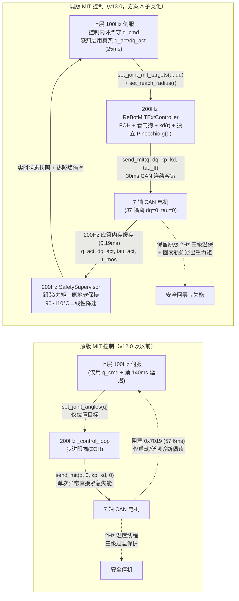

# reBot Arm B601-RS：原版 MIT 控制 vs 现版（v13.0）MIT 控制全面对比

> 本文从**架构接入、MIT 五元组控制律、线程与插值机制、状态反馈、安全与容错策略、上层视觉伺服联动、实机量化指标**七个维度，逐项对比上游原版 MIT 控制器（`rebot_control/rebot/controller.py` `ReBotRSMITController`）与当前 v13.0 扩展版 MIT 控制器（[mit_controller_ext.py](file:///home/tony/wey/rebot_developer/rebot_CV_control/rebot_palm_follow_grasp/mit_controller_ext.py) + [mit_ext.yaml](file:///home/tony/wey/rebot_developer/rebot_CV_control/rebot_palm_follow_grasp/config/mit_ext.yaml)）。

---

## 一、核心结论总览（一表看懂本质差别）

| 对比维度 | 原版 MIT 控制（上游 `ReBotRSMITController` / v12.0 及以前） | 现版 MIT 控制（`ReBotMITExtController` / v13.0 定版） |
| --- | --- | --- |
| **源码与接入方式** | 直接实例化外部仓库 `rebot_control` | **方案 A 运行时子类化**，上游 `rebot_control` 零修改；启动校验上游 `controller.py` SHA256，不一致或 `enable: false` 自动回退原版 |
| **MIT 五元组利用率** | 仅发目标角 `q`，**写死 `dq=0, tau_ff=0, 固定 kp/kd`**（实质为纯位置斜坡模式） | **J1~J6 五元组全部激活**：`q`（FOH 插值）+ `dq`（速度前馈）+ 动态 `kd`（伸展调度）+ `tau_ff`（静重力补偿）；J7 夹爪严格保持纯位置模式 |
| **100Hz → 200Hz 衔接** | 200Hz 线性步进限幅（ZOH 阶梯折线） | **200Hz FOH 一阶保持连续插值**（不超调、不外推）+ `8ms` 速度低通 + `40ms` 看门狗衰减 |
| **关节反馈读取** | 阻塞式 `0x7019` 参数帧，单次耗时 **`57.6 ms`**（独占 `io_lock`），运行中无高频反馈 | **200Hz 零额外请求内存缓存** `motor.get_state()`，耗时 **`0.19 ms`**（快 300 倍），相对 `0x7019` 偏差仅 **`0.014°`** |
| **CAN 通信异常处理** | 200Hz 循环中**单次发送异常即直接紧急失能**（`return_to_zero=False`），屈肘姿态存在自由下落风险 | **`CanFaultMonitor` 30ms（6 拍）连续容错**，过滤偶发丢帧；真断联优先 `return_to_zero` 缓慢回零，回零期带 `1ms` 重试 |
| **重力下垂处理** | 无重力前馈，全靠 `kp` 硬扛；J3/J4 静态下垂 **`2.10° ~ 2.80°`** | 独立线程隔离 Pinocchio + `0.32 kg` Gemini 2 负载计算 `tau_ff`，J3/J4 下垂降至 **`0.27° ~ 0.49°`**（降低 **85%+**），回零自动平滑淡出至 `0 Nm` |
| **悬臂共振与阻尼** | 全工作空间固定 `kp/kd`；且因 `dq_des=0`，加 `kd` 会直接恶化滞后 | 速度前馈解耦带宽与阻尼后，按水平半径 `r ∈ [0.18, 0.36]m` 动态调度 J1~J3 `kd`，J1 3Hz 共振峰压降 **`>1.0 dB`** 且零滞后代价 |
| **主动安全监督** | 仅 2Hz 三级 MOS 过温保护（110 / 125 / 140°C）+ Esc / Ctrl+C | 完整保留三级温保与二次 Ctrl+C，新增 **200Hz `SafetySupervisor`**：跟踪误差 >12° / 过力矩（≥80ms）**原地软保持**（永不半空失能）+ MOS 90~110°C 线性降速 |
| **执行器实测闭环滞后** | **`65 ~ 142 ms`**（全轴实测，J4 高达 142ms，上层按 ~140ms 补偿） | **`20 ~ 30 ms`**（滞后砍掉 **~80%**，J4~J6 `-3dB` 带宽从 `1.5~2.0Hz` 跃升至 **`>4.0Hz`**） |
| **对上层视觉伺服的影响** | 只能拿指令角 `q_cmd` 猜 140ms 延迟；深伸展限速砍至 `46%`、冷静窗 `0.24~0.34s` | 200Hz 真实 `(q_act, dq_act)` 直供世界系 KF 与自运动补偿（延迟重标为纯相机 `25ms`、`smith=1.00`），且与 `q_cmd` 控制内环严格隔离；深伸展解放至 `70%` |

---

## 二、MIT 底层控制律与指令发送逐项对比

### 1. 原版 MIT 下发逻辑（`rebot_control/rebot/controller.py` L419–438）

原版 `_send_mit_positions()` 对全部 7 个电机固定执行：

```python
motor.send_mit(
    float(positions_rad[index]),  # q_des：经 max_speeds 步进截断后的位置目标
    0.0,                          # dq_des：恒为 0！
    float(motor_config.kp),       # kp：yaml 固定值
    float(motor_config.kd),       # kd：yaml 固定值
    0.0,                          # tau_ff：恒为 0！
)
```

电机内部实际执行的力矩方程退化为：

$$\tau = k_p (q_{\text{des}} - q_{\text{act}}) - k_d \dot{q}_{\text{act}}$$

由此带来**三个物理瓶颈**：
1. **阻尼变刹车（滞后根源）**：由于 $\dot{q}_{\text{des}} = 0$，$-k_d \dot{q}_{\text{act}}$ 始终对抗机械臂的正常运动，凭空制造出 $\tau_{\text{lag}} \approx k_d / k_p$ 的相位滞后（例如 J4 $k_p=50, k_d=5$，理论滞后即 $100\text{ ms}$，实测低频滞后达 $142\text{ ms}$）；
2. **带宽与阻尼锁死**：想调大 $k_d$ 抑振，跟随立刻变肉；想调小 $k_d$ 提速，悬臂立刻发抖；
3. **重力全靠位置静差硬扛**：悬臂静止必须下垂 $q_{\text{des}} - q_{\text{act}} \approx \tau_g / k_p$ 才能平衡自重和 Gemini 2 相机重量。

---

### 2. 现版（v13.0）MIT 下发逻辑（[mit_controller_ext.py](file:///home/tony/wey/rebot_developer/rebot_CV_control/rebot_palm_follow_grasp/mit_controller_ext.py)）

现版在 200Hz 循环中对 J1~J6 完整驱动 MIT 五元组：

$$\tau = k_p (q_{\text{foh}} - q_{\text{act}}) + k_d(r) \cdot (\dot{q}_{\text{ff}} - \dot{q}_{\text{act}}) + \tau_{\text{grav}}(q)$$

| 参数通道 | 现版计算与安全约束 |
| --- | --- |
| **`q_send`（目标角）** | 当 `foh_interp_enable=true` 时，用上层 100Hz 下发的目标点与速度在 10ms 间隔内做 **200Hz 向后线性插值（FOH）**，严格限制在 `[prev_q, target_q]` 区间内绝不外推超调；进入旧接口（`set_joint_angles`/`hold`/`move_to_joints`）自动退回平滑斜坡 |
| **`dq_send`（速度前馈）** | 分轴缩放 `vel_ff_scale = [0.70, 0.85, 0.85, 0.90, 0.90, 0.90]` + `8ms` 一阶低通 + `40ms` 看门狗指数衰减（`τ=30ms`）+ `0.2°` 方向冲突保护 + 软限位接触轴清零；**J7 夹爪、保持、点动、回零恒为 `0.0`** |
| **`kd_send`（动态阻尼）** | 按末端水平伸展半径 $r \in [0.18, 0.36]\text{ m}$ 线性调度：`J1: 4.6→6.4`、`J2: 13.5→14.5`、`J3: 14.0→15.0`、`J4~J6` 保持基线 `[5.0, 4.0, 4.0]`；硬钳制在 `[0.8x, 1.8x]` 基线且腕部 RS00 $\le 5.0$，斜率上限 `10.0 / s` |
| **`tau_send`（静态重力前馈）** | 由 [rebot_adapter.py](file:///home/tony/wey/rebot_developer/rebot_CV_control/rebot_palm_follow_grasp/rebot_adapter.py) 中完全线程隔离的 `_grav_model`（URDF + `link6` 上 `0.32 kg` 相机质点）计算静重力 $g(q)$，乘分轴系数 `[0.0, 0.65, 0.80, 0.80, 0.0, 0.0]`；带 `0.5s` 启动淡入、`30 Nm/s` 斜率限幅、单轴硬封顶 `[0, 12, 12, 2.5, 2.0, 1.0] Nm` 与近零位支架光滑淡出 `cradle_zero_fade`（J1/J7 恒为 `0.0`） |

---

## 三、架构与线程数据流对比



---

## 四、反馈、安全与关机路径的逐项细节对比

| 子系统 | 原版行为 | 现版（v13.0）行为 | 解决的实际隐患 |
| --- | --- | --- | --- |
| **启动与移动读当前角** | `read_joint_angles()` 逐轴请求 `0x7019`（`timeout=500ms`，正常耗时 `57.6 ms`） | `get_current_pos_cached()` 优先读 200Hz 缓存（`<0.2 ms`，偏差 `0.014°`），缓存过期/不可信自动回退 `0x7019` | 消除 `move_to_joints` 和高频采样对 `io_lock` 的几十毫秒阻塞 |
| **CAN 瞬时丢包/毛刺** | `_control_loop` 捕获任意一次异常即 `return_to_zero=False, emergency=True` 立刻失能 | `CanFaultMonitor` 连续 `30ms`（6 拍）全失败才触发，且默认 `return_to_zero` 缓慢回零；偶发单帧错误自动恢复并限频日志 | 根除 CAN 总线单帧干扰引起的**屈肘半空掉电自由下落**事故风险 |
| **碰撞 / 机械卡阻保护** | **无**（电机持续输出大电流直至过温或损坏） | 200Hz `SafetySupervisor` 监测 6 轴跟踪误差 `>12.0°`（持续 `≥80ms`）或实测力矩超 `[18,28,28,10,10,10] Nm`（持续 `≥80ms`）→ **原地软保持**（速度置零 + 保留重力补偿，按 `g` 恢复） | 发生误碰或异常卡阻时第一时间卸载冲击且绝不坠臂 |
| **温升保护** | `110°C` 仅打印报警、`125°C` 触发回零停机、`140°C` 紧急断开（2Hz 检测） | 完整保留三级温保，同时在 `90°C → 110°C` 区间提前将上层允许速度线性降额至 `0.40x` | 主动降温延长连续运行时间，避免突然触发高温回零打断任务 |
| **安全回零停机（`_safe_return_to_zero`）** | `smoothstep` 位置回零，`tau_ff=0`，单次发送异常直接中止回零 | 沿用 `smoothstep` 回零与 `1ms` 瞬时重试；回零期间维持静重力补偿并按**回零指令轨迹 `commands[:6]`** 经 `cradle_zero_fade` 在近零位光滑淡出至 `0 Nm`（规避主循环停止后 `q_act` 缓存过期问题） | 回零过程无悬臂下坠、落回支架时无顶撞异响 |
| **二次 Ctrl+C 急停** | 第一次缓慢回零，第二次立即中止回零并失能 | **完全保持一致**（遵循用户操作习惯与物理电源急停配合） | 零学习成本，紧急人工接管行为不变 |
| **可观测性与诊断** | 仅 2Hz 温度列表；想测跟踪误差需额外低频同步读 CAN（`≤2Hz`） | 零开销随 100Hz CSV 同步落盘 200Hz 真实 `qa_1..6`、`dqa_1..6`、`tau_1..6`、`tmos_max`、`mit_period_p99_ms`、`can_fail_total`、`mit_dq_ff_max`、`tau_ff_2..4`、`kd_j1` | 每次运行都可直接算出真实执行滞后、力矩裕度、静差下垂与总线健康度 |

---

## 五、实机量化对比（同硬件 B601-RS + Gemini 2）

所有数据均取自本项目真实硬件日志（`rebotarm_rs.yaml` 相同基线增益 `J1=72/3.6, J2/J3=216/12, J4=50/5, J5~7=50/4`）：

### 1. 单轴频域带宽与相位滞后（`tools/joint_sysid.py`，HOME 位姿）

| 关节 | 原版 MIT（`152733`）<br>1Hz 滞后 / 4Hz 幅值 | 现版 MIT（`155050` + `161548`）<br>1Hz 滞后 / 3Hz 峰 / 4Hz 幅值 | 核心提升 |
| --- | :---: | :---: | --- |
| **J1（底座偏航）** | `70.3 ms` / `-1.97 dB` | **`37~40 ms`** / **`+1.28 dB`**（P1 曾 `+2.35dB`） / `+0.11 dB` | 滞后降 45%，M3 阻尼压平 3Hz 共振峰 `1.07 dB` |
| **J2（大臂）** | `66.5 ms` / `-3.53 dB` | **`22.1 ms`** / `+1.59 dB` / `+0.35 dB` | 滞后降 **67%**，`-3dB` 带宽越过 `4 Hz` |
| **J3（小臂）** | `76.6 ms` / `-6.56 dB` | **`31.2 ms`** / `+0.98 dB` / `-2.11 dB` | 滞后降 **59%**，4Hz 幅值抬升 `+4.45 dB` |
| **J4（腕俯仰）** | `116.2 ms`（0.5Hz 达 **`142 ms`**） / `-9.35 dB` | **`37.7 ms`** / `+0.15 dB` / **`-1.41 dB`** | 滞后降 **68%~73%**，`-3dB` 带宽 `1.5 → >4.0 Hz` |
| **J5（腕偏航）** | `93.8 ms` / `-7.31 dB` | **`25.1 ms`** / `-0.12 dB` / **`-0.33 dB`** | 滞后降 **73%**，4Hz 几乎零衰减 |
| **J6（腕滚转）** | `95.0 ms` / `-7.84 dB` | **`29.9 ms`** / `-0.26 dB` / **`-0.29 dB`** | 滞后降 **69%**，4Hz 几乎零衰减 |

### 2. 静态悬臂下垂（`tools/p3_gravity_verify.py`）

| 悬臂姿态 | 原版 MIT（`tau_ff=0`）<br>J3 / J4 静态下垂 | 现版 MIT（`tau_ff` 开启）<br>J3 / J4 静态下垂 | 改善幅度 |
| --- | :---: | :---: | --- |
| **HOME 姿态** (`r=0.151m`) | `+2.10°` / `+2.80°` | **`+0.27°` / `+0.34°`** | **-87% / -88%** |
| **Extended 姿态** (`r=0.191m`) | `+2.25°` / `+2.68°` | **`+0.36°` / `+0.48°`** | **-84% / -82%** |

### 3. 全速视觉跟手闭环表现（v12.0 原版 MIT vs v13.0 现版 MIT）

| 实机验收指标 | 原版 MIT + v12.0 上层<br>（`213740` / `214900`） | 现版 MIT + v13.0 上层<br>（`170617` / `171409`） |
| --- | :---: | :---: |
| 6 轴执行器闭环滞后 | `~140 ms` | **`20 ~ 30 ms`**（互相关 `r = 0.969 ~ 0.998`） |
| 6 轴跟踪误差中位数 / 峰值 | `~3.43°`（无重力补偿基线） | **`1.87° ~ 1.97°`** / **`5.78° ~ 5.90°`**（远低于 12° 阈值） |
| 分轴跟踪中位误差 `\|ex\| / \|ey\| / \|ez\|` | `4.30~5.68 / 6.10~6.22 / 1.95~2.50 cm` | **`2.68~3.08 / 5.51~6.25 / 1.27~1.52 cm`** |
| 停手稳定耗时中位数 | `0.19 ~ 0.23 s` | **`0.190 ~ 0.210 s`** |
| 稳态静止速度 P95 | `0.000 rad/s` | **`0.000 rad/s`**（`>0.05` 占比 `0.0%`） |
| 200Hz 周期 P99 / CAN 失败 / MOS 峰值 | 未监控 / 无容错 / — | **`5.94 ms`** / **`0 次`** / **`39.0°C`** |

---

## 六、刻意保持不变的部分（向后兼容与安全红线）

为了确保安全与工程可维护性，本次改造**刻意保留了以下全部原版基线**：

1. **上游 `rebot_control` 仓库 0 字节改动**：升级或重拉原厂代码不会丢补丁；若上游修改了 `controller.py`，SHA256 校验会自动拦截并安全回退；
2. **基础 `kp/kd` 配置沿用原厂 `config/rebotarm_rs.yaml`**，不私自覆盖硬件底层配置文件；
3. **单一 CAN 主机架构与 J7 夹爪协议完全不变**；
4. **上层安全硬红线完全不变**：`max_vel ≤ 0.85 m/s`、承重关节 `J2/J3 ≤ 2.0 rad/s`、水平工作空间 `hypot(X, Y) ≤ 0.42 m`、4 层深度保护链；
5. **全功能分级一键回退**（均无需改代码，只改 YAML 重启即生效）：

| 想退回到的层级 | 操作方式 |
| --- | --- |
| 仅关主动安全监督（M6） | `config/mit_ext.yaml` 设 `supervisor_enable: false` |
| 仅关伸展自适应阻尼（M3） | `config/mit_ext.yaml` 设 `gain_sched_enable: false` |
| 仅关静重力前馈（M2） | `config/mit_ext.yaml` 设 `gravity_ff_enable: false` |
| 仅关实测位姿感知接入（P2） | `config/follow.yaml` 设 `mit_actual_feedback_est_enable: false` |
| 仅关速度前馈/FOH（P1），退回纯位置 MIT + CAN 容错 | `config/mit_ext.yaml` 设 `vel_ff_enable: false` |
| **100% 退回原版上游控制器 + v12.0 行为** | `config/mit_ext.yaml` 设 `enable: false`，并加 `--follow-cfg config/follow_v12.yaml` |


## 七、附加

**原来的所谓“MIT 控制”，只是用了 MIT 通信协议/模式，在控制律上本质就是最简的「纯位置 PD 控制」（甚至连参考速度都没有，属于“弹簧 + 固定刹车”）。**

---

### 1. 代码铁证：原版只用了 MIT 五元组里的 3 个参数

在原版上游 [controller.py](file:///home/tony/wey/rebot_developer/MIT_control/rebot_control/rebot/controller.py#L432-L438) 中，每拍发给电机的指令写死为：

```python
motor.send_mit(
    float(positions_rad[index]),  # q_des：目标位置
    0.0,                          # dq_des = 0（写死！）
    float(motor_config.kp),       # kp：yaml 固定常数
    float(motor_config.kd),       # kd：yaml 固定常数
    0.0,                          # tau_ff = 0（写死！）
)
```

代入电机内部的 MIT 力矩公式后，实际执行的控制律退化为：

$$\tau = k_p(q_{\text{des}} - q_{\text{act}}) - k_d \dot{q}_{\text{act}}$$

物理上它等价于：**一根固定劲度系数的弹簧拉向目标角，外加一个对地面的粘滞阻尼器（只要臂在动就拼命踩刹车）**。既没有任何动力学模型信息，也没有轨迹速度跟踪，更没有阻抗调节。

---

### 2. 真正的“MIT 控制”原本是干什么用的？

“MIT 模式”源自 MIT Cheetah 四足机器人（Ben Katz 的准直驱电机控制框架），它把 5 个参数合在一个 CAN 帧里高速下发，核心思想是**“上位机动力学/轨迹前馈 + 电机端高频局部阻抗闭环”**：

$$\tau = \underbrace{\tau_{\text{ff}}}_{\text{动力学前馈（重力 / 惯性 / 科氏力 / 接触力）}} + \underbrace{k_p(q_{\text{des}} - q_{\text{act}}) + k_d(\dot{q}_{\text{des}} - \dot{q}_{\text{act}})}_{\text{轨迹误差 PD 与可编程柔顺阻抗（刚度/阻尼可在线变化）}}$$

五个参数各有不可替代的分工：
1. **`q_des` + `dq_des`**：共同描述“期望轨迹状态”，只有同时给 $\dot{q}_{\text{des}}$，阻尼项 $k_d(\dot{q}_{\text{des}} - \dot{q}_{\text{act}})$ 才只消耗**跟踪误差**而不拖慢正常运动；
2. **`tau_ff`**：由上位机用物理模型提前算出抵消重力/负载/加速度所需的力矩，让电机“未动先承重”，不必靠位置下垂去换力矩；
3. **`kp` + `kd`**：不是写死的常数，而是可根据机械臂构型（如伸展惯量变化）或任务阶段（自由高速巡航 vs 接触柔顺抓取）**在线调节的虚拟刚度与阻尼**。

---

### 3. 三档对比：原版 vs 我们现在（v13.0）vs 理论满血版

| 层级                                  | 实际生效的控制律                                             | 用到的 MIT 能力                                              | 典型表现                                                     |
| ------------------------------------- | ------------------------------------------------------------ | ------------------------------------------------------------ | ------------------------------------------------------------ |
| **原版（v12.0 及以前）**              | $\tau = k_p(q_{\text{des}}-q) - k_d\dot{q}$                  | 仅用 MIT 协议外壳，本质是**纯位置 PD**                       | 滞后 `65~142 ms`、下垂 `2.1~2.8°`、调大 $k_d$ 就变肉         |
| **现版（v13.0）**                     | $\tau = k_p(q_{\text{foh}}-q) + k_d(r)(\dot{q}_{\text{ff}}-\dot{q}) + \tau_{\text{grav}}(q)$ | **真正用上了 MIT 五元组**：速度前馈 + 静重力动力学前馈 + 构型在线变阻尼 | 滞后压至 `20~30 ms`、下垂降 `85%+`、共振峰压平且零滞后代价   |
| **理论满血版（计算力矩 / 柔顺交互）** | 再叠加 $M(q)\ddot{q} + C(q,\dot{q})\dot{q}$ 与接触变刚度 $k_p(t)$ | 含加速度逆动力学与外力柔顺控制                               | 需极干净的轨迹加速度 $\ddot{q}$（如预规划轨迹、抛接球、力控插拔） |

> **为什么我们 v13.0 有意停在“静重力 + 速度前馈 + 变阻尼”，没有再加 $M(q)\ddot{q}$？**
> 因为视觉伺服中相机观测的目标加速度 $\ddot{q}$ 噪声很大，强行注入惯性力矩极易放大视觉抖动并激发高频啸叫；而现版这套组合已经吃掉了这套硬件约 **85%~90%** 的 MIT 理论红利，同时保证了绝对的无源稳定性。
